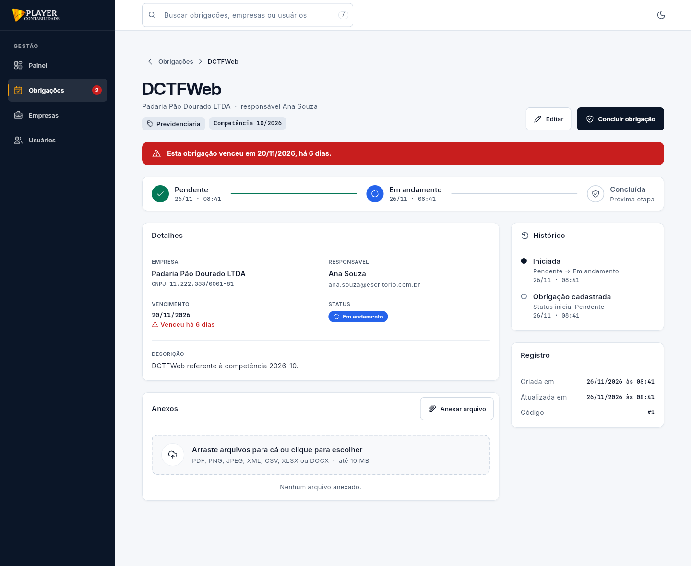
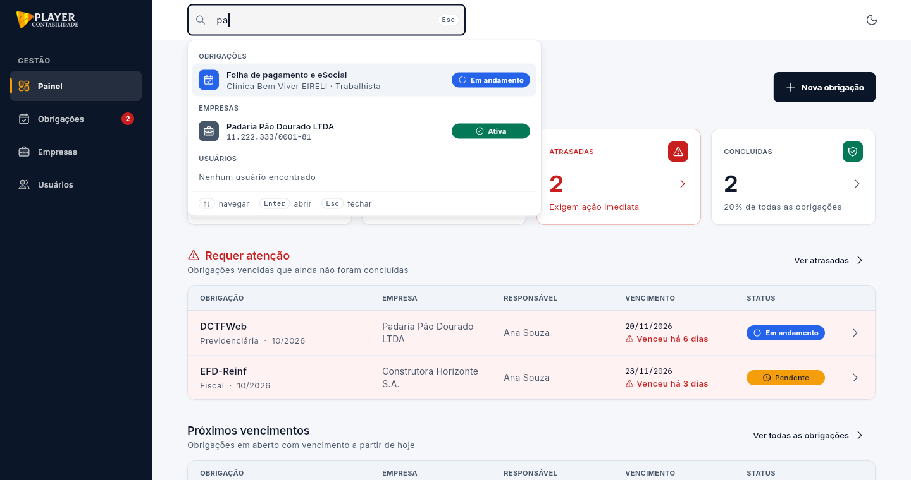
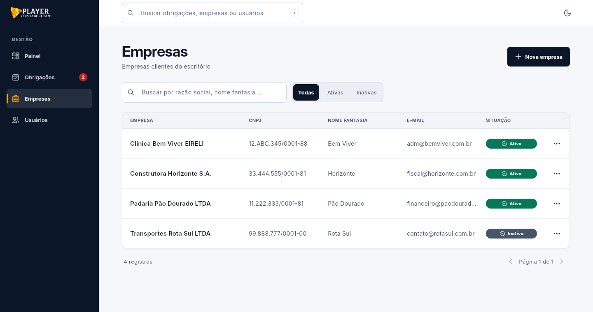
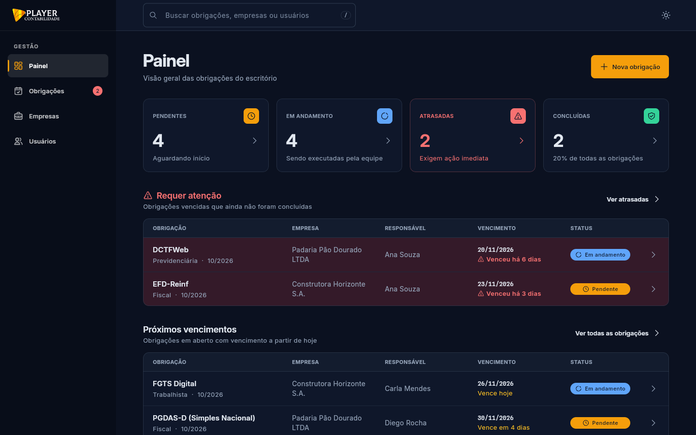
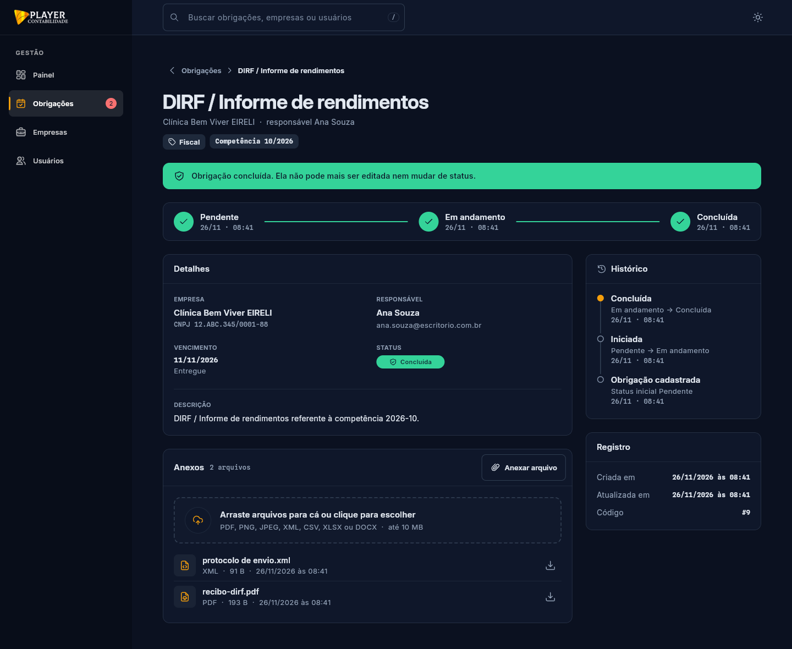
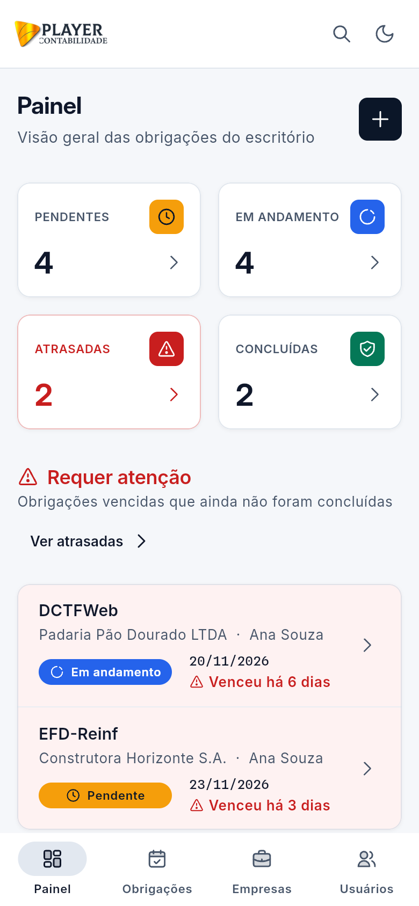
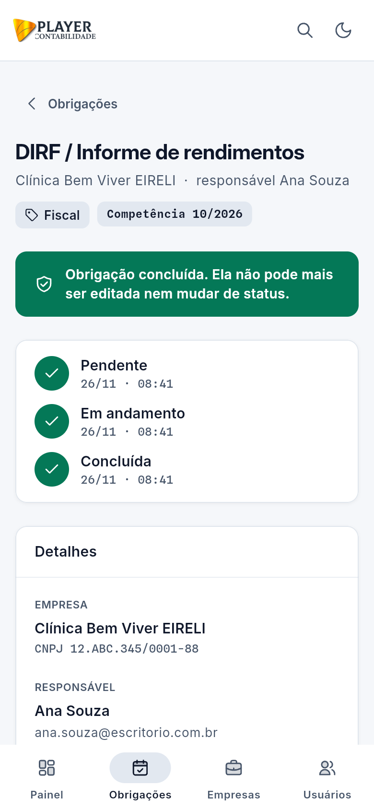

<p align="center">
  <picture>
    <source media="(prefers-color-scheme: dark)" srcset="assets/imagens/logo-player-escuro.png">
    
  </picture>
</p>

<h1 align="center">Gerenciamento de Obrigações · App</h1>

<p align="center">
  Aplicativo Flutter (web e Android) para o escritório acompanhar prazos, responsáveis e documentos das obrigações das empresas clientes.
</p>

<p align="center">
  <a href="https://github.com/rafaelsdiniz/obrigacoes-frontend/actions/workflows/ci.yml"></a>
  
  
  
</p>

<p align="center">
  <a href="https://github.com/rafaelsdiniz/obrigacoes-backend">API (backend)</a> ·
  <a href="https://github.com/rafaelsdiniz/obrigacoes-backend/tree/main/docs">Documentação do sistema</a> ·
  <a href="https://trello.com/b/lO3pOAnQ/sistema-de-gerenciamento-de-obrigacoes-player">Quadro no Trello</a>
</p>

---


## Sumário

- [Telas](#telas)
- [Funcionalidades](#funcionalidades)
- [Tecnologias](#tecnologias)
- [Execução](#execução)
- [Configuração do ambiente](#configuração-do-ambiente)
- [Testes e qualidade](#testes-e-qualidade)
- [Estrutura do projeto](#estrutura-do-projeto)
- [Design system](#design-system)
- [Decisões arquiteturais](#decisões-arquiteturais)
- [Melhorias futuras](#melhorias-futuras)

## Telas

| Obrigações | Detalhe da obrigação |
|---|---|
|  |  |

| Busca global | Nova obrigação |
|---|---|
|  |  |

| Empresas | Usuários |
|---|---|
|  |  |

| Tema escuro | Detalhe no tema escuro |
|---|---|
|  |  |

| Painel no celular | Obrigações no celular | Detalhe no celular |
|---|---|---|
|  |  |  |

## Funcionalidades

| Área | O que o usuário faz |
|---|---|
| **Painel** | Vê os totais por status (pendentes, em andamento, atrasadas e concluídas), que abrem a lista já filtrada, as obrigações que exigem atenção e os próximos vencimentos. |
| **Obrigações** | Busca por título ou descrição; filtra por status (com a contagem em cada aba), somente atrasadas, empresa, responsável, tipo e período de vencimento; ordena por vencimento, cadastro ou título. |
| **Detalhe** | Acompanha as etapas do fluxo com a data de cada uma, o histórico de mudanças e o registro (criação e atualização). Avança o status com um clique: só a próxima etapa é oferecida, e concluir pede confirmação. |
| **Anexos** | Arrasta um ou vários arquivos para a área de envio (ou clica para escolher), baixa e exclui. O tipo e o tamanho são conferidos antes do envio. |
| **Empresas e usuários** | Lista com busca e filtro por situação, cadastro, edição e ativação ou inativação. Inativos continuam consultáveis, mas não aparecem nos seletores de novas obrigações. |
| **Busca global** | Encontra obrigações, empresas e usuários de qualquer tela. Atalho `/`, navegação por `↑` `↓`, `Enter` abre e `Esc` fecha. No celular, abre em tela cheia. |
| **Tema claro e escuro** | Segue o sistema operacional até o usuário escolher pelo botão de sol e lua; a escolha fica salva no dispositivo. |

## Tecnologias

| Área | Escolha |
|---|---|
| Linguagem e framework | Flutter 3.50 e Dart 3.14, com o pacote `material_ui` e URLs de caminho na web |
| Estado e injeção de dependências | Riverpod 3 |
| Rotas | go_router, com URL real na web (link direto, F5 e botão voltar) |
| HTTP | Dio, encapsulado no `ClienteApi`, inclusive para envio multipart |
| Arquivos | file_picker para escolher, desktop_drop para arrastar e soltar, url_launcher para baixar |
| Preferências | shared_preferences, para lembrar o tema escolhido |
| Tipografia | Inter e Inter Display para textos e títulos, Spline Sans Mono para datas e números (licença OFL, empacotadas no app) |
| Testes | flutter_test e mocktail |
| Entrega | Docker (build multi-stage com nginx sem privilégios) e GitHub Actions publicando no GHCR |

## Execução

### Sistema completo com Docker

O jeito mais simples é subir tudo pelo Compose do [backend](https://github.com/rafaelsdiniz/obrigacoes-backend), que inclui o banco, a API e este aplicativo:

```bash
git clone https://github.com/rafaelsdiniz/obrigacoes-backend.git
cd obrigacoes-backend
docker compose up -d --build
```

| Serviço | Endereço |
|---|---|
| Aplicativo | http://localhost:3000 |
| API | http://localhost:8080 |

Para rodar só a imagem deste repositório, com a API já em execução:

```bash
docker build -t obrigacoes-app .
docker run -p 3000:8080 -e API_URL=http://localhost:8080 obrigacoes-app
```

### Em desenvolvimento

Pré-requisitos: Flutter 3.50 ou superior e a API em execução.

```bash
flutter pub get
flutter run -d chrome      # web
flutter run                # Android, com o emulador aberto (a API é acessada por 10.0.2.2)
```

## Configuração do ambiente

A URL da API vem de um destes lugares, nesta ordem:

1. **`/config.json` na raiz do site (web).** O contêiner gera esse arquivo na subida a partir da variável `API_URL`, então a mesma imagem serve qualquer ambiente:
   ```json
   { "apiUrl": "https://api.exemplo.com.br" }
   ```
2. **`--dart-define=API_URL=...` no build ou no `flutter run`.**
3. **Padrão:** `http://localhost:8080`, ou `http://10.0.2.2:8080` no emulador Android.

| Onde | Variável | Padrão | Descrição |
|---|---|---|---|
| Contêiner (nginx) | `API_URL` | `http://localhost:8080` | Endereço da API como o navegador o enxerga; vira o `/config.json` |
| Build (`--dart-define`) | `API_URL` | `http://localhost:8080` ou `http://10.0.2.2:8080` no Android | Usado quando não há `/config.json` (desenvolvimento e Android) |

No Android, HTTP sem TLS só é permitido para `10.0.2.2` e `localhost` (`android/app/src/main/res/xml/network_security_config.xml`). Em um aparelho físico, use a API por HTTPS ou inclua o endereço da máquina nesse arquivo antes de gerar o app.

A imagem usa nginx sem privilégios, com fallback para a SPA, gzip, cabeçalhos de segurança, `Cache-Control: no-cache` (cada deploy chega ao navegador no próximo acesso) e health check.

## Testes e qualidade

```bash
dart format --set-exit-if-changed lib test
flutter analyze
flutter test --coverage
```

| Tipo | O que cobre |
|---|---|
| Unidade | Formatação (CNPJ, datas, competência, tamanhos), regras de prazo, filtros e períodos de vencimento, preferência de tema |
| Repositórios | Parâmetros e corpo enviados à API e leitura das respostas, com um adaptador HTTP falso |
| Contrato | Os repositórios contra um servidor que responde exatamente como a API documentada |
| Telas | O aplicativo inteiro sobe com os repositórios substituídos por falsos e navega pelas rotas reais: painel, listas, filtros e ordenação, detalhe e avanço de status, formulários, anexos (seletor e arrastar e soltar), busca global e troca de tema |
| Layout e acessibilidade | Todas as rotas em 4 tamanhos de tela com texto em dobro e sem estouro; contraste WCAG AA nos temas claro e escuro, alvos de toque de 48 px e rótulos para leitor de tela |

O CI roda formatação, análise, testes com cobertura mínima de 80% e o build web em todo pull request; na `main`, publica a imagem no GHCR.

## Estrutura do projeto

```text
lib/
├── main.dart                 carrega a configuração e o tema salvo e inicia o app
├── app/                      MaterialApp, roteador e navegação (barra lateral, barra superior e barra inferior)
├── core/
│   ├── tema/                 paleta clara e escura, tokens de raio, fonte e movimento, preferência de tema
│   ├── layout/               pontos de quebra, largura da página, altura dos controles e margens
│   ├── config/               URL da API (/config.json ou --dart-define)
│   ├── dominio/              Json, situação, filtro e termos dos cadastros
│   ├── estado/               filtro reaproveitável dos cadastros e aviso de alteração entre telas
│   ├── arquivos/             escolha, arrastar e soltar e download de arquivos
│   ├── formatacao/           CNPJ, datas, competência, tamanhos de arquivo e validações
│   ├── http/                 cliente da API, erros (Problem Details), página e parâmetros
│   └── widgets/              componentes: cabeçalhos, trilha, cartões, filtros, menus, listas e formulários
└── features/
    ├── painel/               indicadores e seções do painel
    ├── obrigacoes/           lista com filtros, detalhe com etapas e histórico, formulário e regra de prazo
    ├── anexos/               área de envio, lista, download e exclusão
    ├── busca/                busca global em obrigações, empresas e usuários
    ├── empresas/
    └── usuarios/
```

As funcionalidades que falam com a API (obrigações, anexos, empresas e usuários) são divididas em três camadas. O painel e a busca global só compõem dados dessas funcionalidades, então têm apenas `presentation` (e o modelo do resultado, no caso da busca):

| Camada | Responsabilidade |
|---|---|
| `data` | Repositórios que falam com a API e convertem JSON em modelo |
| `domain` | Modelos imutáveis e regras de exibição (prazo, filtros, períodos) |
| `presentation` | Telas, providers e as operações que alteram dados |

## Design system

A interface usa um conjunto pequeno de tokens, para que todas as telas tenham o mesmo tamanho, forma e cor:

| Token | Valores | Onde |
|---|---|---|
| Paleta (`Paleta`) | Neutros azul-acinzentados, marinho da marca, amarelo da logo como acento e status em uma mesma intensidade (azul, verde, vermelho e amarelo) | `context.cores`, com versão clara e escura |
| Raios (`Raios`) | 8 para controles, 12 para cartões, pílula para status e contadores | Botões, campos, filtros, cartões, faixas |
| Altura (`Medidas.alturaDoControle`) | 48 px em todo controle interativo | Busca, abas, filtros, botões |
| Ícones (`TamanhosDeIcone`) | 14, 18, 20 e 32 | Status, botões, navegação e estados vazios |
| Largura (`Medidas.larguraMaximaDaPagina`) | 1600 px, com a barra superior alinhada ao conteúdo | Todas as páginas |

As cores de status têm significado fixo e sempre vêm acompanhadas de ícone e texto, nunca só da cor.

## Decisões arquiteturais

As decisões do sistema estão registradas nos [ADRs do backend](https://github.com/rafaelsdiniz/obrigacoes-backend/tree/main/docs/adr); a do frontend é a [ADR-0008](https://github.com/rafaelsdiniz/obrigacoes-backend/blob/main/docs/adr/0008-arquitetura-do-frontend.md). Em resumo:

- **Organização por funcionalidade** (`features/<nome>/{data,domain,presentation}`): cada assunto fica junto, e as telas nunca falam com HTTP diretamente.
- **Riverpod para estado:** cada fonte de dados é um provider com estados de carregando, erro e dados. As operações que alteram dados ficam em uma classe por funcionalidade (`CadastroDeObrigacoes`, `GestaoDeAnexos`), que invalida o que precisa ser recarregado.
- **Erros tratados em um único ponto:** o `ClienteApi` converte qualquer falha em `ErroApi`, com o código estável do Problem Details. Erros de validação aparecem no próprio campo; conflito de versão oferece "Recarregar".
- **O backend é a fonte das regras.** O app só as reflete para dar uma experiência melhor: oferece apenas a próxima ação de status, lista só cadastros ativos nos seletores e usa o campo `atrasada` calculado pela API, no fuso do escritório. Os filtros, a ordenação e as contagens das abas vêm da própria API.
- **Configuração em tempo de execução** (`/config.json`): a mesma imagem serve qualquer ambiente.
- **Uma base para web e Android:** barra lateral e tabelas em telas largas; barra inferior, linhas empilhadas e busca em tela cheia no celular.
- **Acessibilidade verificada por teste:** contraste nos dois temas, alvos de toque, texto em dobro e rótulos para leitor de tela fazem parte da suíte, não de uma revisão manual.

## Melhorias futuras

- Login e perfis de acesso, acompanhando a autenticação da API.
- Busca dentro dos seletores de empresa e responsável (hoje até 100 cadastros ativos por lista).
- Progresso em porcentagem no envio de anexos e pré-visualização de PDFs e imagens.
- Notificações de vencimento no aplicativo.
- Testes de ponta a ponta automatizados (`integration_test`) contra a API real no CI.
