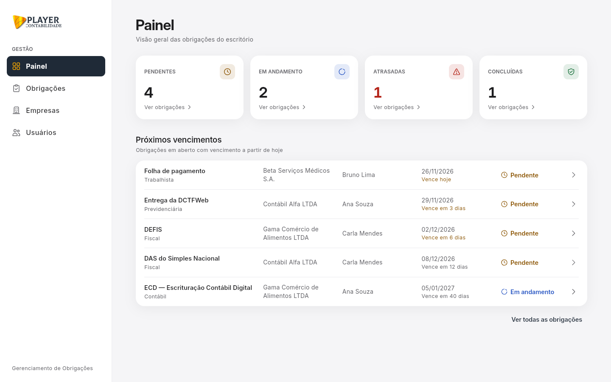
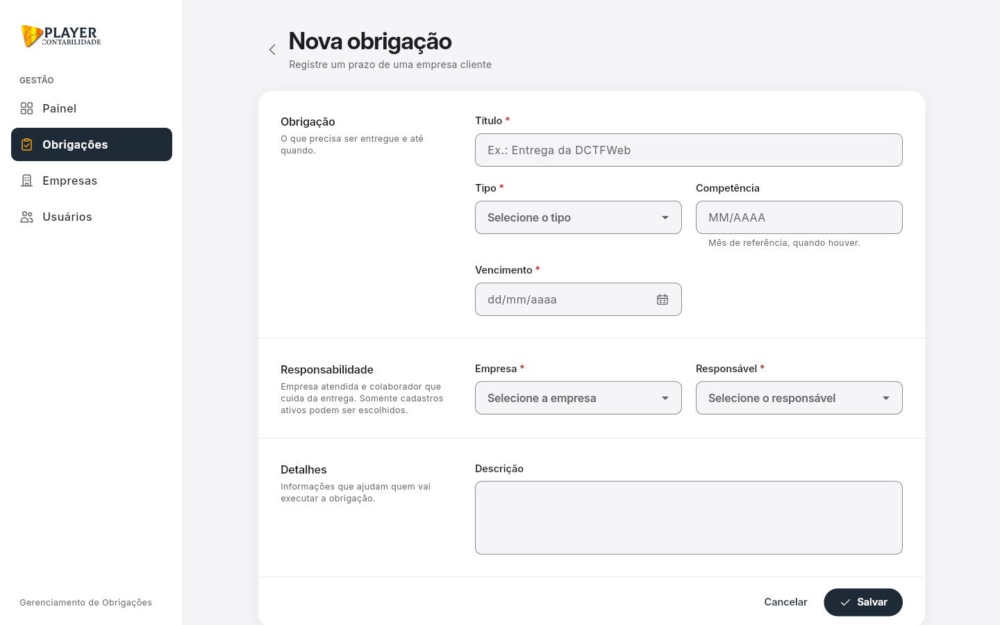
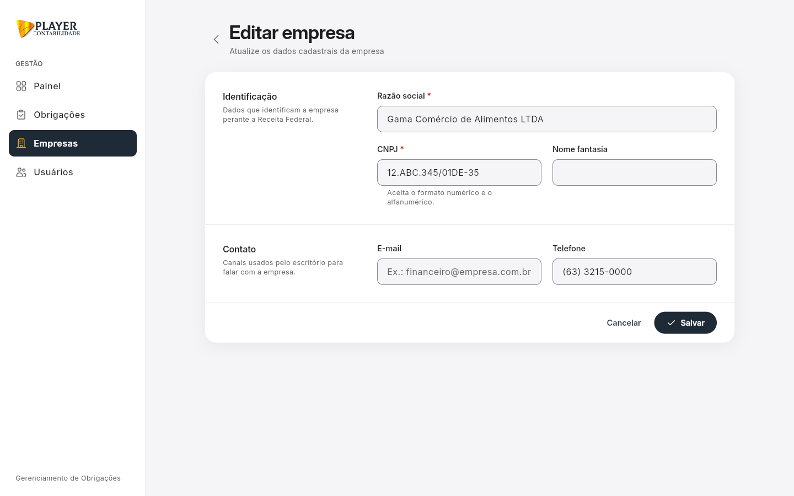
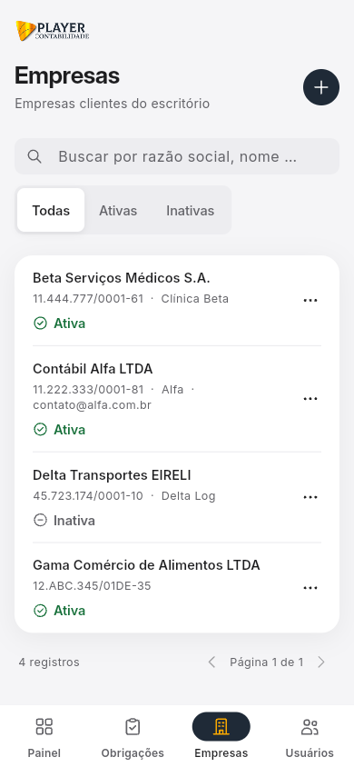
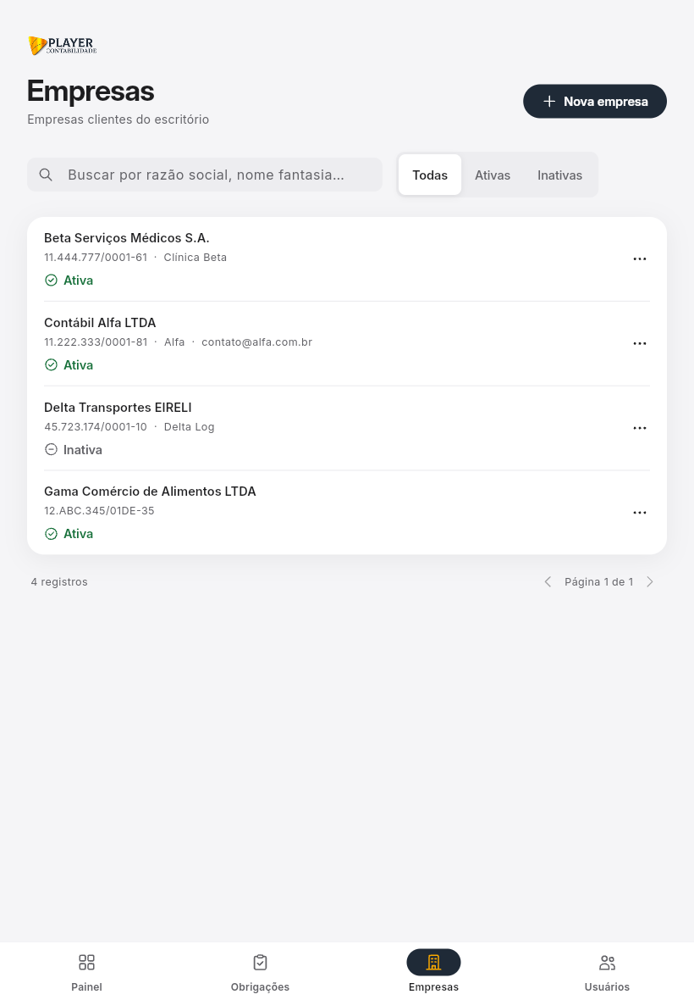

# Obrigações App

Aplicativo Flutter (web e Android) para gerenciamento das obrigações das empresas clientes de um escritório de contabilidade.

Consome a API do repositório [obrigacoes-backend](https://github.com/rafaelsdiniz/obrigacoes-backend), onde também está a [documentação completa do sistema](https://github.com/rafaelsdiniz/obrigacoes-backend/tree/main/docs). O andamento do projeto está no [quadro do Trello](https://trello.com/b/lO3pOAnQ/sistema-de-gerenciamento-de-obrigacoes-player).



| Obrigações | Detalhe da obrigação |
|---|---|
|  |  |

| Nova obrigação | Empresas |
|---|---|
|  |  |

| Painel no celular | Obrigações no celular | Detalhe no celular |
|---|---|---|
|  |  |  |

| Edição de empresa | Usuários |
|---|---|
|  |  |

| Empresas no celular | Cadastro no celular | Tablet |
|---|---|---|
|  |  |  |

## Tecnologias

- Flutter 3.50 e Dart 3.14, com o pacote `material_ui` e URLs de caminho na web
- Identidade visual da Player: cores da marca, tipografia Inter (licença OFL, empacotada no app) e layout responsivo de tela inteira
- Riverpod 3 para estado e injeção de dependências
- go_router para rotas com URLs reais na web
- Dio como cliente HTTP
- flutter_test e mocktail para testes

## Execução

Pré-requisitos: Flutter 3.50 ou superior e a API em execução (veja o README do backend).

```bash
flutter pub get
flutter run -d chrome
```

A URL da API padrão é `http://localhost:8080`. Para usar outra:

```bash
flutter run -d chrome --dart-define=API_URL=http://192.168.0.10:8080
```

### Configuração em tempo de execução

Na web, o aplicativo lê o arquivo `/config.json` da raiz do site antes de iniciar:

```json
{ "apiUrl": "https://api.exemplo.com.br" }
```

Se o arquivo não existir, vale o `API_URL` definido no build. Assim, a mesma build serve qualquer ambiente. Fora da web, sem `API_URL`, o padrão é `http://localhost:8080`, ou `http://10.0.2.2:8080` no emulador Android.

## Testes e qualidade

```bash
flutter analyze
dart format --set-exit-if-changed lib test
flutter test
```

## Estrutura

```text
lib/
├── main.dart                 carrega a configuração e inicia o app
├── app/                      MaterialApp, roteador e navegação (barra lateral ou barra inferior)
├── core/
│   ├── tema/                 cores, raios e tema da identidade visual
│   ├── layout/               pontos de quebra e margens responsivas
│   ├── config/               URL da API (/config.json ou --dart-define)
│   ├── dominio/              Json, situação, filtro e termos dos cadastros
│   ├── estado/               notifiers reaproveitáveis
│   ├── formatacao/           CNPJ (máscara e validação) e validações de formulário
│   ├── http/                 cliente da API, erros (Problem Details), página e parâmetros
│   └── widgets/              componentes da interface: cabeçalho, grupo, linhas, selos, filtros, formulários
└── features/
    ├── painel/               indicadores e próximos vencimentos
    ├── obrigacoes/           lista, detalhe com andamento e histórico, formulário, regras de prazo
    ├── empresas/             data (repositório), domain (modelo) e presentation (telas, estado e rotas)
    └── usuarios/
```

Cada funcionalidade é dividida em três camadas:
- `data`: fala com a API;
- `domain`: modelos imutáveis;
- `presentation`: telas e estado.

Os erros da API chegam às telas como `ErroApi`, com o código estável e os erros por campo, que aparecem no próprio campo do formulário.
