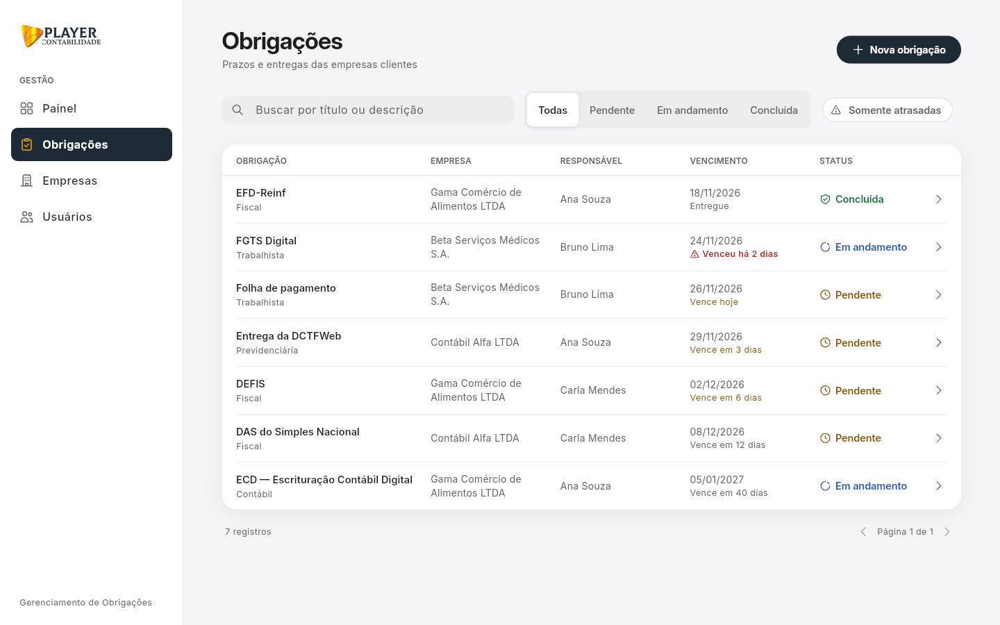
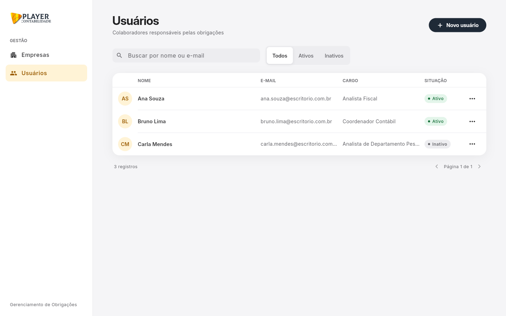

# Obrigações App

Aplicativo Flutter (web e Android) para gerenciamento das obrigações das empresas clientes de um escritório de contabilidade.

Consome a API do repositório [obrigacoes-backend](https://github.com/rafaelsdiniz/obrigacoes-backend), onde também está a [documentação completa do sistema](https://github.com/rafaelsdiniz/obrigacoes-backend/tree/main/docs). O andamento do projeto está no [quadro do Trello](https://trello.com/b/lO3pOAnQ/sistema-de-gerenciamento-de-obrigacoes-player).


| Obrigações | Detalhe da obrigação |
|---|---|
|  |  |

| Nova obrigação | Empresas |
|---|---|
|  |  |

| Painel no celular | Obrigações no celular | Detalhe no celular |
|---|---|---|
|  |  |  |

| Edição de empresa | Usuários |
|---|---|
|  |  |

| Empresas no celular | Cadastro no celular | Tablet |
|---|---|---|
|  |  |  |

## Tecnologias

- Flutter 3.50 e Dart 3.14, com o pacote `material_ui` e URLs de caminho na web
- Identidade visual da Player: cores da marca, tipografia Inter (licença OFL, empacotada no app) e layout responsivo de tela inteira
- Riverpod 3 para estado e injeção de dependências
- go_router para rotas com URLs reais na web
- Dio como cliente HTTP, inclusive para envio de arquivos (multipart)
- file_picker para escolher anexos e url_launcher para baixá-los
- flutter_test e mocktail para testes

## Funcionalidades

- **Painel:** totais de obrigações pendentes, em andamento, atrasadas e concluídas, que abrem a lista já filtrada, e os próximos vencimentos.
- **Obrigações:** lista com busca e filtros por status e atraso; detalhe com as etapas do fluxo, histórico e anexos; cadastro e edição.
- **Empresas e usuários:** listas com busca e filtro por situação, cadastro, edição e ativação/inativação.
- **Anexos:** envio, lista, download e exclusão dos arquivos de cada obrigação.

## Execução

### Com Docker (sistema completo)

O jeito mais simples é subir tudo pelo Compose do [backend](https://github.com/rafaelsdiniz/obrigacoes-backend):

```bash
docker compose up -d --build
```

O aplicativo fica em http://localhost:3000 e a API em http://localhost:8080.

Para rodar só a imagem deste repositório:

```bash
docker build -t obrigacoes-app .
docker run -p 3000:8080 -e API_URL=http://localhost:8080 obrigacoes-app
```

### Em desenvolvimento

Pré-requisitos: Flutter 3.50 ou superior e a API em execução.

```bash
flutter pub get
flutter run -d chrome      # web
flutter run                # Android, com o emulador aberto (a API é acessada por 10.0.2.2)
```

A URL da API padrão é `http://localhost:8080`. Para usar outra:

```bash
flutter run -d chrome --dart-define=API_URL=http://192.168.0.10:8080
```

### Configuração em tempo de execução

Na web, o aplicativo lê o arquivo `/config.json` da raiz do site antes de iniciar:

```json
{ "apiUrl": "https://api.exemplo.com.br" }
```

Se o arquivo não existir, vale o `API_URL` definido no build. Assim, a mesma build serve qualquer ambiente. Fora da web, sem `API_URL`, o padrão é `http://localhost:8080`, ou `http://10.0.2.2:8080` no emulador Android.

| Onde | Variável | Padrão | Descrição |
|---|---|---|---|
| Contêiner (nginx) | `API_URL` | `http://localhost:8080` | Endereço da API como o navegador o enxerga; vira o `/config.json` na subida do contêiner |
| Build (`--dart-define`) | `API_URL` | `http://localhost:8080` ou `http://10.0.2.2:8080` no Android | Usado quando não há `/config.json` (desenvolvimento e Android) |

A imagem usa nginx sem privilégios, com fallback para a SPA (as URLs funcionam com F5 e link direto), gzip, cabeçalhos de segurança e health check.

## Testes e qualidade

```bash
flutter analyze
dart format --set-exit-if-changed lib test
flutter test --coverage
```

- Testes de unidade (formatação, regras de prazo, repositórios com um adaptador HTTP falso) e de tela, que sobem o aplicativo inteiro com os repositórios substituídos por falsos e navegam pelas rotas reais.
- Testes de layout e acessibilidade: todas as rotas em 4 tamanhos de tela com texto em dobro, contraste WCAG AA, alvos de toque de 48 px e rótulos para leitor de tela.
- O CI roda formatação, análise, testes com cobertura mínima de 80% e o build web em todo pull request; na `main`, publica a imagem no GHCR.

## Estrutura

```text
lib/
├── main.dart                 carrega a configuração e inicia o app
├── app/                      MaterialApp, roteador e navegação (barra lateral ou barra inferior)
├── core/
│   ├── tema/                 cores, raios e tema da identidade visual
│   ├── layout/               pontos de quebra e margens responsivas
│   ├── config/               URL da API (/config.json ou --dart-define)
│   ├── dominio/              Json, situação, filtro e termos dos cadastros
│   ├── estado/               notifiers reaproveitáveis
│   ├── arquivos/             escolha de arquivos no dispositivo e download
│   ├── formatacao/           CNPJ, datas, competência, tamanhos de arquivo e validações
│   ├── http/                 cliente da API, erros (Problem Details), página e parâmetros
│   └── widgets/              componentes da interface: cabeçalho, grupo, linhas, selos, filtros, formulários
└── features/
    ├── painel/               indicadores e próximos vencimentos
    ├── obrigacoes/           lista, detalhe com andamento e histórico, formulário, regras de prazo
    ├── anexos/               envio, lista, download e exclusão dos arquivos de uma obrigação
    ├── empresas/             data (repositório), domain (modelo) e presentation (telas, estado e rotas)
    └── usuarios/
```

Cada funcionalidade é dividida em três camadas:
- `data`: fala com a API;
- `domain`: modelos imutáveis;
- `presentation`: telas e estado.

### Anexos

Na tela da obrigação, a seção **Anexos** envia um arquivo por vez, lista os enviados e permite baixar ou excluir.
- O seletor só oferece as extensões aceitas pela API: PDF, PNG, JPEG, XML, CSV, XLSX e DOCX.
- Arquivos acima de 10 MB são recusados antes do envio, para não carregar na memória algo que a API vai recusar. O valor fica em `Anexo.tamanhoMaximo` e acompanha o padrão do backend (`APP_ANEXOS_TAMANHO_MAXIMO`); a API continua sendo quem decide, conferindo o tipo pelo conteúdo e o tamanho.
- O download abre o endereço do anexo em uma nova aba. A API responde com `Content-Disposition: attachment` e o nome original, então o navegador salva o arquivo e fecha a aba; se a API responder com erro, ele aparece na aba nova, sem perder o estado do app. No Android, o endereço abre no navegador.
- Obrigação concluída continua aceitando anexos (por exemplo, o recibo da entrega), mas não permite excluí-los.

Os erros da API chegam às telas como `ErroApi`, com o código estável e os erros por campo, que aparecem no próprio campo do formulário.

## Decisões arquiteturais

As decisões do sistema estão registradas nos [ADRs do backend](https://github.com/rafaelsdiniz/obrigacoes-backend/tree/main/docs/adr) (a do frontend é a [ADR-0008](https://github.com/rafaelsdiniz/obrigacoes-backend/blob/main/docs/adr/0008-arquitetura-do-frontend.md)). Em resumo:

- **Organização por funcionalidade** (`features/<nome>/{data,domain,presentation}`): cada assunto fica junto, e as telas nunca falam com HTTP diretamente.
- **Riverpod para estado:** cada fonte de dados é um provider com estados de carregando, erro e dados. As operações que alteram dados ficam em uma classe por funcionalidade (`CadastroDeObrigacoes`, `GestaoDeAnexos`), que invalida o que precisa ser recarregado.
- **Erros tratados em um único ponto:** o `ClienteApi` converte qualquer falha em `ErroApi`, com o código estável do Problem Details. Erros de validação aparecem no próprio campo; conflito de versão oferece "Recarregar".
- **O backend é a fonte das regras.** O app só as reflete para dar uma experiência melhor: mostra apenas a próxima ação de status, lista só cadastros ativos nos seletores e usa o campo `atrasada` calculado pela API, no fuso do escritório.
- **Configuração em tempo de execução** (`/config.json`): a mesma imagem serve qualquer ambiente.
- **Uma base para web e Android:** barra lateral e tabelas em telas largas; barra inferior e linhas empilhadas no celular.
- **Identidade visual da Player:** dourado da marca como acento e grafite como base; cores de status com significado fixo e sempre acompanhadas de ícone e texto.

## Melhorias futuras

- Login e perfis de acesso, acompanhando a autenticação da API.
- Busca dentro dos seletores de empresa e responsável (hoje até 100 cadastros ativos por lista).
- Progresso em porcentagem no envio de anexos e pré-visualização de PDFs e imagens.
- Filtros por empresa, responsável e período na lista de obrigações (a API já os oferece).
- Modo escuro e testes de ponta a ponta automatizados (integration_test) no CI.
